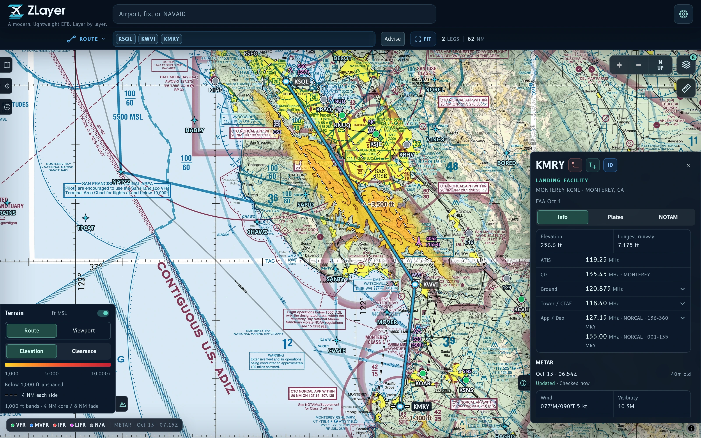

# ZLayer

ZLayer is a free, open-source electronic flight bag (EFB) and flight planner for
phones, tablets and desktops. Use it to plan routes on FAA charts, read approach
plates, and check aviation weather and NOTAMs. It runs in a browser and can be
installed as a progressive web app (PWA), with regional downloads for offline use.

You can use it at [zlayer.tedyin.com](https://zlayer.tedyin.com/). You don't need an
account or subscription, and ZLayer will stay free. The [About page](https://zlayer.tedyin.com/about/)
has answers to common questions about installation, offline use and data sources.

[](https://zlayer.tedyin.com/)

*Check chart editions and weather times in the app; the screenshot is an example.*

## Features

- **Charts and navigation:** FAA VFR sectionals and IFR low/high charts, with search
  for airports, NAVAIDs, fixes and VFR waypoints.
- **Routes:** Plan with airports, fixes and airways, look up preferred and TEC
  routes, preview published procedures, and save named routes locally.
- **Weather:** METARs, TAFs, PIREPs, advisories, AWC/WPC analysis and forecasts, cloud,
  icing and wind fields, and NOAA radar with recent history.
- **Plates and notices:** Approach plates, airport diagrams, Chart Supplements,
  airport and procedure NOTAMs, and graphical TFRs.
- **Map tools:** Terrain along a route or across the map, FAA obstructions, glide
  planning, distance measurement and optional device GPS.
- **Offline downloads:** Download charts and data for supported U.S. states and
  territories. Settings shows progress, chart editions and storage status.

ZLayer remembers your route, map position, open panels and place in a plate when
you reload. The [Route Stash](src/layers/routes/README.md) saves named routes,
including feature pins and approach attachments, for later use.

## Using ZLayer

1. Open [zlayer.tedyin.com](https://zlayer.tedyin.com/) in a browser with WebGL2.
2. To install on iPhone or iPad, use Safari → Share → **Add to Home Screen**.
   On Android, use Chrome's install or **Add to Home Screen** option.
   You can also use a desktop browser tab.
3. For offline use, open **Settings → Offline**, download your regions, and wait
   for **Saved**. On iOS, install first and download inside the installed app.
   Disconnect from the network and check the charts and plates you need before
   relying on them offline.

Routes, settings and downloads belong to the browser or installed app where you
saved them. They do not sync between devices; you can copy or share route text to
move a route to another device.

A regional download includes VFR and IFR low/high charts, navigation data,
applicable procedure and Chart Supplement books, and plates available only as
individual files. Verified saved editions stay in use through feed updates and
outages. Choosing a different date to browse does not change your saved edition.
Files you view also enter the cache, but that does not mean the whole region has
been saved. See [offline storage](docs/features/offline-storage.md) for details.

Regional downloads do not include complete satellite basemap coverage. Fresh
weather needs an internet connection, and FAA charts and procedures are limited
to the coverage available in the feed. Downloads along a route corridor and
satellite weather imagery are still planned; the [roadmap](docs/product/roadmap.md)
tracks those and other remaining work.

## Limitations

ZLayer targets modern desktop browsers, Android Chrome and iOS/iPadOS Safari 18+.
Offline use, low-storage behavior, GPS and performance still need testing in
installed iOS and Android apps before release. Desktop browser tests can't cover
those checks. See [browser compatibility](docs/verification/graphics-compatibility.md)
and [offline storage](docs/features/offline-storage.md) for the requirements.

ZLayer is a supplemental planning tool, not an official briefing source or a
certified EFB. It does not file flight plans, calculate fuel or aircraft performance,
or assure terrain clearance. The experimental AHRS toolbox has not been validated
in flight.

## Development

Use Node.js 24 or newer and run commands from the repository root:

```bash
npm ci
npm run dev
```

The development server proxies weather and NOTAM requests to `https://zlayer.tedyin.com`
and FAA chart assets to `charts.tedyin.com`. This uses the same data feeds as
production. To run your own weather and NOTAM backend, see the
[info server guide](tools/info-server/README.md).

The app lives in `src/`, the info server in `tools/info-server/`, tests in `test/`,
and local proxy rules in `tools/dev-proxy.ts`. Only `packages/contracts` and
`packages/domain` are npm workspaces. `npm run build` produces the static site in
`dist/`; the [deployment guide](docs/development/deployment.md) covers hosting it
and putting the info server behind an HTTPS reverse proxy.

Run `npm run verify:full` before committing, subject to the server-only scope rule
in [AGENTS.md](AGENTS.md#verification-and-documentation). The
[verification guide](docs/development/local-development.md#verification) lists
browser prerequisites, focused commands, and the local and GitHub CI checks.

### Design

Cached charts and routes load first, then refresh in the background. FAA features
and weather render as MapLibre layers rather than individual DOM markers. Airport
details open the selected procedure or minimums page directly. Layers show their
data source and valid time, and flag stale, incomplete or unavailable data. The
[design principles](docs/product/direction.md) explain these choices.

`faa-regs` generates the FAA chart, NASR and d-TPP feed. ZLayer reads chart coverage
from its manifests and provides the map, routing, weather, procedure viewer and
offline storage. The basemap stays visible outside the available chart coverage.

## Documentation

- [Documentation index](docs/README.md)
- [Direction and principles](docs/product/direction.md)
- [Current capabilities and roadmap](docs/product/roadmap.md)
- [Architecture](docs/architecture/overview.md)
- [Layer design and source layout](docs/architecture/layer-plugins.md)
- [Local development and verification](docs/development/local-development.md)
- [Offline storage, regional downloads and device checks](docs/features/offline-storage.md)
- [Deployment and hosting](docs/development/deployment.md)

## License

Copyright (C) 2026 ZLayer contributors.

Except where otherwise noted, ZLayer's original source code and accompanying
documentation are licensed under the **GNU Affero General Public License,
version 3 only** (`AGPL-3.0-only`). You may redistribute and modify this software
under those terms; see [LICENSE](LICENSE) for the full license. It is provided
without any warranty, including the implied warranties of merchantability or
fitness for a particular purpose.

Commercial use and forks are welcome. Distributing a covered version requires
providing its corresponding source under the AGPL. If you modify the program and
let users interact with that version remotely over a network, you must prominently
offer those users its corresponding source at no charge. The full license governs
these obligations; contributing changes upstream is welcome but is not required.

Separately licensed material retains its existing terms and notices, including the
[SIL Open Font License for the bundled Noto glyphs](public/fonts/Noto%20Sans%20Bold/LICENSE.md),
and third-party dependencies. Incorporated public-domain material remains public
domain. Aviation data, charts, map tiles and other external content are subject to
their own source terms; see the [source register](docs/data/sources.md).
